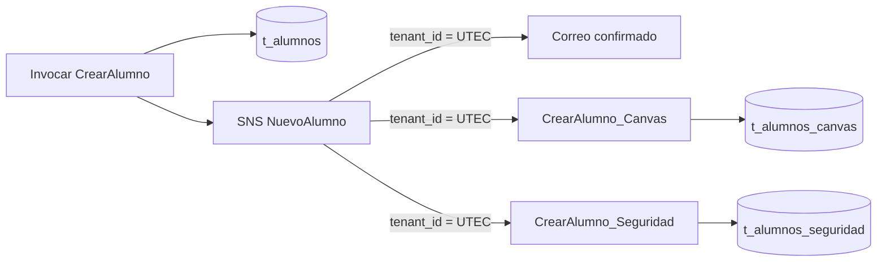

# Semana 13, Taller 1: Nuevo Alumno en UTEC

Implementación del ejercicio de arquitectura orientada a eventos de CS2032. Se despliega **desde una instancia EC2** con Serverless Framework v3. EC2 es la estación de despliegue; la ejecución usa Lambda, SNS y DynamoDB.

## Arquitectura



`CrearAlumno` guarda todos los datos y publica el evento con el atributo SNS `tenant_id`. Los dos suscriptores Lambda almacenan `tenant_id`, `alumno_id` y `alumno_nombre`. El PDF no define el esquema del sistema de seguridad; la tabla de seguridad es una simulación mínima de ese destino. Las tres suscripciones filtran `UTEC` usando atributos del mensaje. Un evento `UNIV2` sí queda en `t_alumnos`, pero no llega al correo ni a las tablas de Canvas y Seguridad.

## Antes del despliegue

- Cuenta AWS de destino para este laboratorio: `904208419583`; región: `us-east-1`.
- Rol de ejecución Lambda definido en `serverless.yml`: `LabRole` de la cuenta AWS activa (`${aws:accountId}`). Este rol debe poder escribir en DynamoDB, publicar en SNS y escribir logs en CloudWatch. La identidad que ejecuta `serverless deploy` también necesita permisos para crear el stack y pasar `LabRole` a Lambda.
- Una instancia EC2 Amazon Linux 2023 con acceso a Internet, Git, Node.js, npm, AWS CLI y credenciales temporales o un perfil de instancia válidos de la **misma cuenta**. `LabRole` en la configuración es el rol de las Lambda; no configura automáticamente las credenciales de EC2.
- Un correo propio para recibir y confirmar la suscripción de SNS.
- Nombres `NuevoAlumno`, `t_alumnos`, `t_alumnos_canvas`, `t_alumnos_seguridad` y las tres Lambda libres en la cuenta/región. El taller supone que aún no existen.

## Despliegue desde EC2

Conéctate por SSH o EC2 Instance Connect a una instancia Amazon Linux 2023. En su terminal:

```bash
sudo dnf install -y git nodejs22 nodejs22-npm python3
node --version
aws --version
aws sts get-caller-identity --query Account --output text
aws iam get-role --role-name LabRole --query 'Role.Arn' --output text
```

**Detente si la cuenta no es `904208419583` o el ARN de `LabRole` no pertenece a esa cuenta.** Selecciona el perfil/credenciales del laboratorio de esa cuenta antes de seguir. Evita guardar claves permanentes en el repositorio.

La AMI de Amazon Linux suele traer AWS CLI. Si `aws --version` no funciona, instálalo siguiendo la [guía oficial de AWS CLI v2](https://docs.aws.amazon.com/cli/latest/userguide/getting-started-install.html).

```bash
git clone https://github.com/DiegoLadrondeGuevara/cloud13.git
cd cloud13
npm ci
npx serverless --version
export NOTIFICATION_EMAIL='tu-correo@gmail.com'
npx serverless deploy --region us-east-1 --stage dev
```

Sustituye el correo por el tuyo. Si Serverless solicita iniciar sesión en la organización `diegoladrondeg`, usa `npx serverless login`; confirma luego que el proveedor de AWS de Serverless esté conectado a la cuenta `904208419583` antes de repetir el despliegue.

Serverless v3.40 puede mostrar una advertencia de validación para `python3.12` porque su lista interna de runtimes está desactualizada. La plantilla compilada conserva `python3.12`, admitido por Lambda; esa advertencia no impide empaquetar el servicio.

Abre el mensaje de Amazon SNS que llega al correo indicado y pulsa **Confirm subscription**. Sin esa confirmación no se entregarán las notificaciones por correo.

## Pruebas del taller

Desde `cloud13` en EC2, una vez que la suscripción de correo diga `Confirmed`:

```bash
aws lambda invoke --region us-east-1 --function-name CrearAlumno --cli-binary-format raw-in-base64-out --payload fileb://events/alumno-utec.json response-utec.json
cat response-utec.json
```

La respuesta debe tener `statusCode: 200`. SNS invoca a los suscriptores de forma asíncrona; espera unos segundos y consulta cada tabla:

```bash
aws dynamodb get-item --region us-east-1 --table-name t_alumnos --key '{"tenant_id":{"S":"UTEC"},"alumno_id":{"S":"2020777990"}}'
aws dynamodb get-item --region us-east-1 --table-name t_alumnos_canvas --key '{"tenant_id":{"S":"UTEC"},"alumno_id":{"S":"2020777990"}}'
aws dynamodb get-item --region us-east-1 --table-name t_alumnos_seguridad --key '{"tenant_id":{"S":"UTEC"},"alumno_id":{"S":"2020777990"}}'
```

Comprueba el correo de Nuevo Alumno. Luego prueba que el filtro excluye otra universidad:

```bash
aws lambda invoke --region us-east-1 --function-name CrearAlumno --cli-binary-format raw-in-base64-out --payload fileb://events/alumno-univ2.json response-univ2.json
cat response-univ2.json
aws dynamodb get-item --region us-east-1 --table-name t_alumnos --key '{"tenant_id":{"S":"UNIV2"},"alumno_id":{"S":"2021G64747"}}'
aws dynamodb get-item --region us-east-1 --table-name t_alumnos_canvas --key '{"tenant_id":{"S":"UNIV2"},"alumno_id":{"S":"2021G64747"}}'
aws dynamodb get-item --region us-east-1 --table-name t_alumnos_seguridad --key '{"tenant_id":{"S":"UNIV2"},"alumno_id":{"S":"2021G64747"}}'
```

Las últimas dos consultas no deben devolver `Item`. Tampoco debe llegar un correo para `UNIV2`. El filtro de SNS puede tardar hasta 15 minutos en propagarse después de crearse o modificarse; espera ese tiempo si el resultado inicial es inesperado.

## Capturas para el documento

1. **Tras `aws sts get-caller-identity`:** terminal EC2 con la cuenta `904208419583`, sin mostrar claves.
2. **Tras `serverless deploy`:** salida de despliegue correcto y stack en CloudFormation.
3. **Antes de probar:** tema `NuevoAlumno` en la consola SNS con tres suscripciones: email, Canvas y Seguridad. Abre el detalle de cada una para mostrar `tenant_id = UTEC` y el correo confirmado.
4. **Tras invocar UTEC:** respuesta exitosa de `CrearAlumno` y registro UTEC en `t_alumnos`.
5. **Tras unos segundos:** registro UTEC en `t_alumnos_canvas`.
6. **Tras unos segundos:** registro UTEC en `t_alumnos_seguridad`; esta es la evidencia principal del ejercicio propuesto.
7. **Tras recibir el correo:** mensaje de Nuevo Alumno en tu bandeja (oculta datos personales que no quieras compartir).
8. **Tras invocar UNIV2:** registro presente en `t_alumnos` y búsquedas sin `Item` en Canvas y Seguridad; verifica también que no llegó correo nuevo.

## Prueba local y limpieza

```bash
python3 -m unittest discover -s tests -v
```

Cuando ya hayas guardado las evidencias, puedes retirar la infraestructura desde EC2 con `npx serverless remove --region us-east-1 --stage dev`. Esto **elimina las tres tablas y sus datos**; exporta primero cualquier evidencia o dato que necesites conservar. La instancia EC2 se detiene o elimina por separado.
